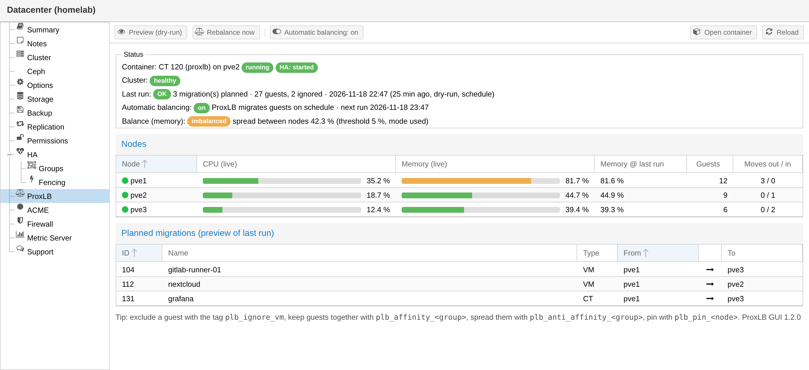
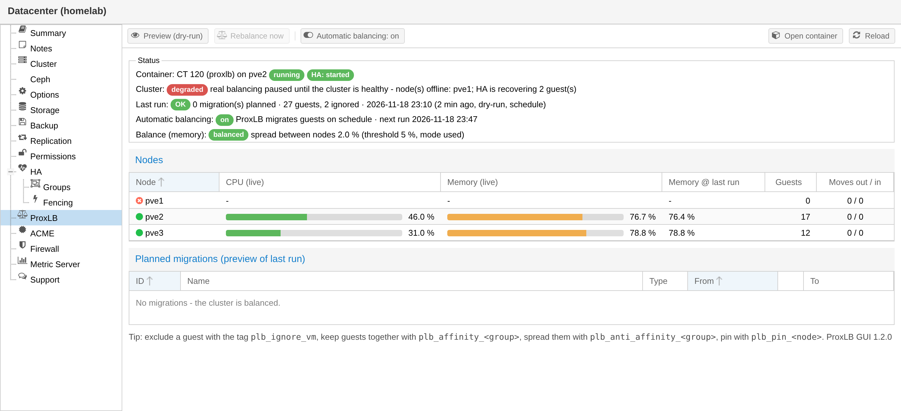

# ProxLB as an LXC container + Proxmox web-interface plugin

[](https://github.com/credativ/ProxLB/actions/workflows/15-contrib-proxmox.yml)

This directory deploys ProxLB in its own **LXC container** on Proxmox VE and
adds a **ProxLB** tab to the Proxmox web interface (*Datacenter → ProxLB*), so
you can see at a glance how balanced the cluster is and what ProxLB plans to
do or has done.



*Rendered from the real plugin code with sample data (`gui/preview/make-screenshot.sh`).*

```
┌──────────── Proxmox VE web interface (any node) ────────────┐
│ Datacenter → ProxLB                                         │
│  [Preview (dry-run)] [Rebalance now] [Automatic: off]       │
│  Status   CT 120 running · last run OK, 3 migrations planned│
│  Nodes    pve1  CPU ███░░ 41%   Mem ██████░ 78%   out 3     │
│           pve2  CPU █░░░░ 12%   Mem ██░░░░░ 31%   in  3     │
│  Planned  101 web01  VM  pve1 → pve2  ...                   │
└────────────────▲───────────────────────────┬────────────────┘
   reads Notes   │                           │ adds tags
   of the CT     │      Proxmox API          │ proxlb-cmd-*
┌────────────────┴───────────────────────────▼────────────────┐
│ LXC "proxlb" (tag proxlb, plb_ignore_vm)                    │
│   proxlb-agent  → runs  python -m proxlb -j [-d]            │
│                 → writes the status into the CT Notes       │
└─────────────────────────────────────────────────────────────┘
```

No extra ports, reverse proxy, CORS or certificates are needed. The GUI only
uses the normal Proxmox API with the logged-in user's session.

> **Step-by-step guide:** [GUI-PLUGIN.md](GUI-PLUGIN.md) explains how to add the plugin and connect it
> to ProxLB, including an existing ProxLB container, **ProxLB on another machine**
> (`proxlb-external` + `install-agent.sh`), user rights and troubleshooting.

## Install as .deb package (recommended)

GitHub Actions builds the **`proxlb-pve`** package on every change
([workflow](../../.github/workflows/50-build-deb-proxlb-pve.yml)). Install it on **every** node whose web
interface you use:

```bash
wget https://github.com/credativ/ProxLB/releases/latest/download/proxlb-pve_latest_all.deb
apt install ./proxlb-pve_latest_all.deb
```

Every release (`v*` tag) carries `proxlb-pve_<version>_all.deb` and the stable name
`proxlb-pve_latest_all.deb` used above ([releases page](https://github.com/credativ/ProxLB/releases)).
Every build of `main` and of pull requests is also available as a workflow artifact.

The package:

* enables the **Datacenter → ProxLB** tab right away on that node,
* re-applies it automatically after every `pve-manager` update (dpkg trigger, no apt hook),
* brings the **`proxlb-lxc`** command with the ProxLB source bundled, so no git is needed on the host,
* replaces an earlier script install of the plugin on that node,
* removes the tab cleanly with `apt remove proxlb-pve`,
* ships this guide and [GUI-PLUGIN.md](GUI-PLUGIN.md) in `/usr/share/doc/proxlb-pve/`.

Then create the container on **one** node. Options are the same as below:

```bash
proxlb-lxc --ip 192.168.1.50/24 --gw 192.168.1.1
proxlb-lxc --upgrade <CTID>        # after updating the package: update ProxLB in the CT
```

Build it yourself: `contrib/proxmox/packaging/build-deb.sh` (output in `dist/`). To test:
`contrib/proxmox/packaging/test-deb.sh dist/proxlb-pve_*_all.deb` (as root on a throwaway Debian box or container).

## Install from git

On **one** Proxmox VE node, as root:

```bash
git clone https://github.com/credativ/ProxLB.git
cd ProxLB/contrib/proxmox
bash proxlb-lxc.sh                                   # DHCP on vmbr0
# or
bash proxlb-lxc.sh --ip 192.168.1.50/24 --gw 192.168.1.1 --storage local-zfs
```

Then reload the web interface (Ctrl+F5) and open **Datacenter → ProxLB**.

The script:

1. creates the user `proxlb@pve`, the role `ProxLB` (`Datastore.Audit, Sys.Audit,
   VM.Audit, VM.Migrate`) on `/`, and the role `ProxLBAgent` (`VM.Config.Options`)
   only on the ProxLB container itself. Each container gets its own API token,
   `proxlb@pve!lxc<CTID>`,
2. creates an unprivileged Debian 13 (or 12) container tagged `proxlb` and
   `plb_ignore_vm`, so ProxLB never migrates itself,
3. installs ProxLB and `proxlb-agent` in `/opt/proxlb/venv`,
4. writes `/etc/proxlb/proxlb.yaml` with every cluster node as API host and the
   cluster CA as trusted CA, so TLS verification stays on,
5. installs the GUI plugin on **all** cluster nodes over the cluster's root SSH,
6. makes the container HA when the storage allows it (see below).

Useful options (`bash proxlb-lxc.sh --help` lists them all):

| Option | Default | |
|---|---|---|
| `--ctid` | next free | container ID |
| `--ip` / `--gw` / `--bridge` / `--vlan` | `dhcp` / - / `vmbr0` / - | network |
| `--storage` | `local-lvm` | rootfs storage |
| `--interval` / `--interval-format` | `1` / `hours` | how often ProxLB runs |
| `--method` | `memory` | `memory`, `cpu` or `disk` |
| `--balanciness` | `5` | allowed spread between nodes in % |
| `--active` | off | balance for real on schedule right away |
| `--no-gui` / `--gui-this-node-only` | | GUI plugin installation |
| `--upgrade CTID` | | update ProxLB, agent and GUI of an existing CT |
| `--ha` / `--no-ha` / `--enable-ha CTID` | auto | high availability, see below |

## Safe by default

Scheduled runs are **dry-runs** (preview only) until you switch on
**Automatic balancing** in the GUI, or install with `--active`. The first run
after the agent starts is always a dry-run, so a reboot never triggers
migrations on its own. **Rebalance now** always asks for confirmation.

## High availability (a node goes down, ProxLB keeps working)

By default the installer makes the ProxLB container **highly available** with
Proxmox HA (`ha-manager add ct:<CTID>`). When the node it runs on fails, Proxmox
fences that node and starts the container on another node. The agent there
starts again and connects to any cluster node that is still reachable.

| Container storage | What the installer does |
|---|---|
| Shared (Ceph RBD/CephFS, NFS, CIFS, iSCSI, shared LVM, ...) | HA only, no data loss |
| Local **ZFS** (`local-zfs`) | storage replication to every other node (every 5 min, `--repl-schedule`) + HA. The CT restarts from the last replica, so at most a few minutes of agent state are lost. |
| Other local storage (`local-lvm`, dir) | not possible. Move the disk first: `pct move-volume <CTID> rootfs <shared-storage>`, then run `bash proxlb-lxc.sh --enable-ha <CTID>` |

* For an existing install: `bash proxlb-lxc.sh --enable-ha <CTID>` (works from any node).
* `--no-ha` skips it. `--ha` warns loudly when it is not possible.
* HA needs quorum. In a **2-node cluster** the surviving node has no quorum and
  HA cannot act, so add a QDevice first (`pvecm qdevice setup <ip>`).

**Balancing pauses while the cluster is degraded.** When a node is offline
(and not in `ignore_nodes`), or HA is fencing or recovering guests, the agent
turns every real run, scheduled or *Rebalance now*, into a dry-run. That way
ProxLB never fights HA recovery or piles guests onto the survivors. It resumes
automatically when the cluster is healthy again. To turn this off, set
`pause_when_degraded: false` in `/etc/proxlb/agent.yaml`.



*Node pve1 has failed: HA restarted its guests elsewhere and ProxLB pauses balancing (sample data).*

The GUI plugin is installed on every node, so the tab keeps working from any
surviving node's web interface.

## Using the GUI

* **Preview (dry-run)**: ProxLB calculates and shows the migrations it would make.
* **Rebalance now**: one real balancing run.
* **Automatic balancing on/off**: scheduled runs migrate, or only preview.
* **Nodes**: live CPU and memory per node, memory at the last run, maintenance
  state, and how many guests move out of or into each node.
* **Balance**: the live spread between the nodes for the configured method,
  compared with `balanciness`.

The tab appears for users with `Sys.Audit` on `/`. Buttons need
`VM.Config.Options` on the ProxLB container. Behind the scenes they add a tag
(`proxlb-cmd-dryrun`, `proxlb-cmd-run`, `proxlb-active`) that the agent
picks up within ~10 seconds.

The container's own **Notes** also show a short summary.

## Inside the container

```bash
pct enter <CTID>
proxlb-ctl dryrun     # queue a preview
proxlb-ctl run        # queue a real balancing run
proxlb-ctl status     # last status (JSON)
proxlb-ctl last       # log of the last run
proxlb-ctl logs       # follow the agent journal
proxlb-ctl config     # edit /etc/proxlb/proxlb.yaml (picked up on the next run)
proxlb-ctl update     # git pull + reinstall (when installed from git)
```

All ProxLB options (affinity, pools, maintenance nodes, PSI, solver, ...) work
as documented in [docs/03_configuration.md](../../docs/03_configuration.md).
`service.schedule` sets the run interval. `service.daemon` and
`service.enable_ha` are ignored because the agent schedules the runs.

## GUI plugin only / remove

```bash
bash gui/install-gui.sh --all-nodes          # install / update
bash gui/install-gui.sh --uninstall --all-nodes
```

The plugin is `/usr/share/pve-manager/js/proxlb-gui.js`, loaded by one line in
`/usr/share/pve-manager/index.html.tpl`. A `pve-manager` update overwrites that
template, so an apt hook (`/etc/apt/apt.conf.d/99proxlb-gui`) adds the line back
automatically.

## Development / CI

GitHub Actions (`.github/workflows/15-contrib-proxmox.yml`) runs on every change under `contrib/proxmox/`:

* **shellcheck** for the installer, GUI installer and `proxlb-ctl`,
* **agent tests** on Python 3.11 and 3.13 (Debian 12 / 13 containers),
* **GUI tests** (`node --test contrib/proxmox/gui/tests/plugin.test.js`), plus a render on real
  ExtJS that fails on any page error. The screenshots are uploaded as an artifact,
* an **installer bundle** (`proxlb-proxmox.tar.gz`) as an artifact, ready to copy to a node,
* the **`proxlb-pve` .deb** (`50-build-deb-proxlb-pve.yml`): build + lintian, install/trigger/upgrade/remove
  tests on Debian bookworm and trixie, and the package attached to the release of every `v*` tag
  (an optional nightly pre-release from `main` when the repository variable `PROXLB_PVE_NIGHTLY` is `true`).

Locally: `node --test contrib/proxmox/gui/tests/plugin.test.js` and
`pytest tests/test_contrib_proxmox_agent.py`.

## Notes

* Migrating guests with **local disks** is off in the generated config. To turn on
  `with_local_disks`, also grant `Datastore.AllocateSpace` to `proxlb@pve`.
* If you restricted tags (*Datacenter → Options → Tag Style → User Allow*),
  allow the `proxlb-*` tags for the users who should press the buttons.
* Removing everything: `pct destroy <CTID>`, `pveum user delete proxlb@pve`,
  `pveum role delete ProxLB`, `pveum role delete ProxLBAgent`, and
  `bash gui/install-gui.sh --uninstall --all-nodes`.
